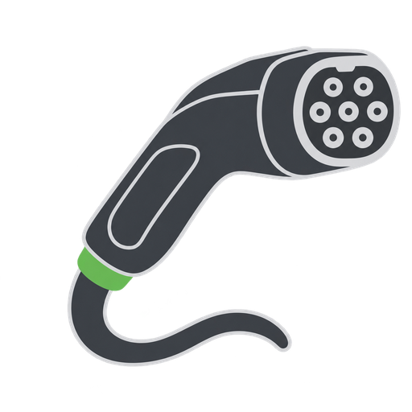

# Project artwork

This community project uses its own EV charging plug artwork and ordinary typography. The text “for AlphaESS” describes the supported devices; the artwork does not reproduce the manufacturer's emblem or wordmark. This is not an official AlphaESS integration or an indication of manufacturer endorsement.

## Home Assistant

- `brand/icon.png`: square integration icon with **for AlphaESS**, 256 × 256 pixels.
- `brand/icon@2x.png`: 512 × 512 version.
- `brand/logo.png` and `brand/logo@2x.png`: English horizontal logo, 768 × 256 and 1536 × 512 pixels.
- `brand/dark_logo.png` and `brand/dark_logo@2x.png`: light title lettering for dark backgrounds.
- All PNGs retain transparency. The square icon has a light outline; the normal icon is used for both themes.
- `docs/assets/charging-plug.png`: optional 512 × 512 symbol without lettering, available if the small text proves too small in practice.

The shared integration icon is deliberately independent of wallbox generation. The Portal-Profil diagnostic sensor still chooses the existing `g1t.png` or `g2t.png` product photo. Neither device metadata nor control behavior changes.

## Small-size review

The lettering is necessarily tiny at 32 px. Check in the installed Home Assistant frontend before release; these previews let reviewers compare the supplied square icon with the optional text-free symbol.

| Size | Selected icon | Optional symbol |
| --- | --- | --- |
| 32 px |  |  |
| 48 px |  |  |
| 64 px |  |  |

Source artwork was generated with an image-generation tool and selected by the project contributor. Packaged versions are resized PNG exports; no corporate logo permission is claimed.

Home Assistant brand asset format: https://contributors.home-assistant.io/core/integrations/brands/
